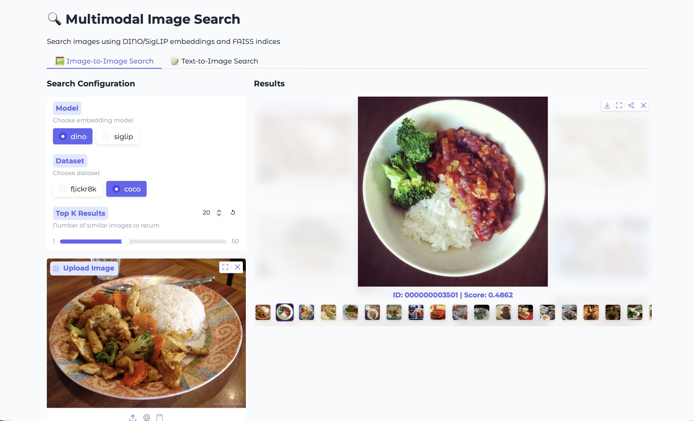
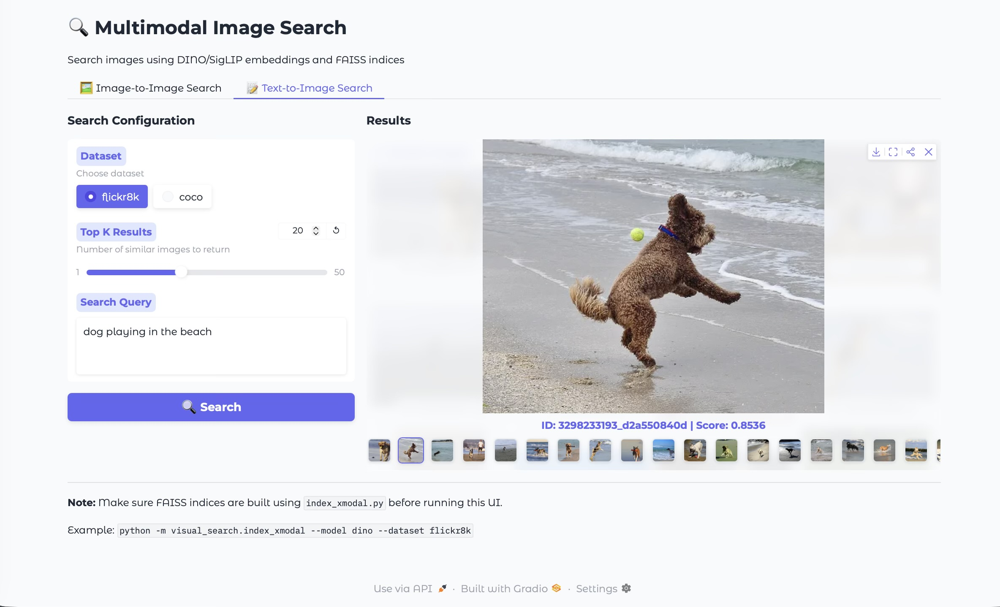

Title: Building visual search with DINOv3 and SigLIP 2
Date: 2026-01-21 10:00
Slug: visual-search
Status: published
save_as: 001_visual_search.html
tags: RAG, search, embeddings
category: demo
url: 001_visual_search.html
Summary: A practical visual search project using DINOv3 and SigLIP 2 embeddings, USearch indexing, and a Gradio interface.

This post walks through the core pieces of a modern visual search stack: image embeddings, text embeddings, fast indexing, and an interactive demo. The focus is on practical, minimal examples you can adapt to your own datasets.

## Image‑to‑Image Search with DINO and SigLIP

Image‑to‑image search has a simple pattern:

1. Encode a query image into an embedding vector.
2. Encode all dataset images into embeddings.
3. Retrieve nearest neighbors in embedding space.

Below is a minimal example using Hugging Face Transformers for both DINO and SigLIP. DINO is strong for fine‑grained similarity; SigLIP is highly semantic and works well even when the visual match is not exact.

```python
import torch
from PIL import Image
from transformers import AutoImageProcessor, AutoModel

device = "mps" if torch.backends.mps.is_available() else "cpu"

# DINO v3
dino_id = "facebook/dinov3-vits16plus-pretrain-lvd1689m"
dino_processor = AutoImageProcessor.from_pretrained(dino_id)
dino_model = AutoModel.from_pretrained(dino_id).to(device).eval()

image = Image.open("query.jpg").convert("RGB")
inputs = dino_processor(images=image, return_tensors="pt").to(device)

with torch.inference_mode():
	dino_outputs = dino_model(**inputs)
	dino_embedding = dino_outputs.last_hidden_state[:, 0]  # CLS token

# SigLIP2 (image encoder)
siglip_id = "google/siglip2-base-patch16-naflex"
siglip_processor = AutoImageProcessor.from_pretrained(siglip_id)
siglip_model = AutoModel.from_pretrained(siglip_id).to(device).eval()

inputs = siglip_processor(images=image, return_tensors="pt").to(device)
with torch.inference_mode():
	siglip_embedding = siglip_model.get_image_features(**inputs)
```

Use a separate index for each encoder. DINO and SigLIP vectors belong to different embedding spaces; text queries must search an index built from the matching SigLIP image encoder.

## Text‑to‑Image Search with SigLIP

SigLIP provides aligned text and image embeddings, making text‑to‑image search straightforward: embed the text, then search against the image embeddings.

```python
import torch
from transformers import AutoProcessor, AutoModel

device = "mps" if torch.backends.mps.is_available() else "cpu"

siglip_id = "google/siglip2-base-patch16-naflex"
processor = AutoProcessor.from_pretrained(siglip_id)
model = AutoModel.from_pretrained(siglip_id).to(device).eval()

text = "a dog catching a frisbee"
inputs = processor(text=text, return_tensors="pt", padding="max_length", max_length=64, truncation=True).to(device)

with torch.inference_mode():
	text_embedding = model.get_text_features(**inputs)
```

## Accelerating Inference on Apple M‑Series (MPS)

Apple Silicon users can get significant speedups by placing models on the MPS backend. The following pattern works across DINO and SigLIP:

```python
import torch
from transformers import AutoModel

device = "mps" if torch.backends.mps.is_available() else "cpu"
model = AutoModel.from_pretrained("facebook/dinov3-vits16plus-pretrain-lvd1689m")
model = model.to(device).eval()
```

## bfloat16 vs float16 vs float32

Precision choice is a trade‑off between numerical range, stability, and memory:

- **float16 (fp16)**: 1 sign bit, 5 exponent bits, 10 mantissa bits. Range is limited compared to bf16/fp32, so it can overflow/underflow more easily. Memory is **2 bytes** per value.
- **bfloat16 (bf16)**: 1 sign bit, 8 exponent bits, 7 mantissa bits. It matches fp32’s exponent range (better dynamic range than fp16) but has less precision in the mantissa. Memory is **2 bytes** per value.
- **float32 (fp32)**: 1 sign bit, 8 exponent bits, 23 mantissa bits. Best precision and range, but uses **4 bytes** per value.

For inference, supported precision depends on the model, backend, hardware, and software versions. Start with float32 as a baseline, then measure accuracy, latency, and memory before reducing precision.

On Apple Silicon, reduced precision can save memory, but support and numerical stability depend on the macOS and PyTorch versions. Check embeddings for non-finite values and compare retrieval results against a float32 baseline before using float16 or bfloat16.

```python
# Conservative starting point; benchmark reduced precision separately.
model = model.to(device=device, dtype=torch.float32).eval()
```

## Indexing and searching with USearch

USearch is a fast, lightweight vector index that works well on consumer hardware and supports half‑precision storage to save space. The snippet below builds an index and searches using a text query embedding (for text‑to‑image search):

```python
import numpy as np
from usearch.index import Index

# Assume image_embeddings is a NumPy array of shape [N, D]
# and text_embedding is a NumPy array of shape [D]

index = Index(
	ndim=image_embeddings.shape[1],
	metric="cos",
	dtype="f16",  # half precision storage for smaller index
)

index.add(np.arange(len(image_embeddings)), image_embeddings)

query = text_embedding / np.linalg.norm(text_embedding)
results = index.search(query, count=10)
top_ids = results.keys
```

FAISS is another option for vector indexing. This project uses USearch; benchmark index choices on your own hardware and data.

The examples illustrate the encoding and indexing steps; running them requires model dependencies and a dataset. See the [SigLIP 2 model card](https://huggingface.co/google/siglip2-base-patch16-naflex) and [USearch documentation](https://github.com/unum-cloud/usearch) for API details.

## Gradio Demo

Gradio provides a quick way to demo image‑to‑image and text‑to‑image search with a clean UI. Here are screenshots from the demo:






These ideas are packaged into this project with a full implementation and demo UI: [Github link](https://github.com/bistaumanga/visual_search_demo)

---

**Acknowledgment:** This project and this blog post were developed with the help of GitHub Copilot and Gemini 3 Pro (via the Gemini Assist VSCode tool).
